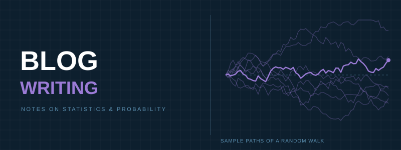
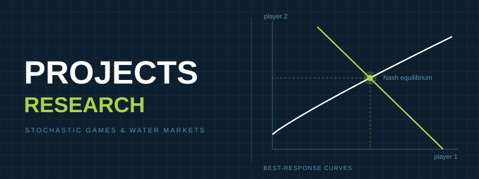
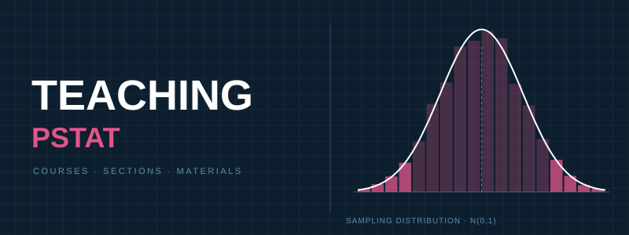

<style>
/* Research interest chips */
.chips {
  display: flex;
  flex-wrap: wrap;
  gap: 0.35rem;
  margin: 0.75rem 0;
}
.chip {
  display: inline-block;
  padding: 0.22rem 0.65rem;
  border-radius: 999px;
  font-size: 0.8rem;
  font-weight: 500;
  line-height: 1.4;
}
.chip-outline {
  border: 1.5px solid var(--bs-primary, #0d6efd);
  color: var(--bs-primary, #0d6efd);
}

/* Stat highlight row */
.stat-row {
  display: flex;
  gap: 1.5rem;
  margin: 1rem 0 1.1rem;
  flex-wrap: wrap;
}
.stat-item {
  display: flex;
  flex-direction: column;
  line-height: 1.2;
}
.stat-num {
  font-size: 1.3rem;
  font-weight: 700;
  color: var(--bs-primary, #0d6efd);
}
.stat-label {
  font-size: 0.75rem;
  color: #888;
  text-transform: uppercase;
  letter-spacing: 0.04em;
}

/* Areas cards */
#blog-latest .card,
#projects-latest .card,
#teaching-latest .card {
  border: 1px solid rgba(var(--bs-primary-rgb, 13,110,253), 0.25);
  border-radius: 0.6rem;
  box-shadow: 0 2px 8px rgba(0,0,0,0.06);
  transition: box-shadow 0.2s ease, transform 0.2s ease;
}
#blog-latest .card:hover,
#projects-latest .card:hover,
#teaching-latest .card:hover {
  box-shadow: 0 5px 18px rgba(0,0,0,0.12);
  transform: translateY(-3px);
}
.video-embed {
  position: relative;
  width: 100%;
  aspect-ratio: 16 / 9;
  border-radius: 0.6rem;
  overflow: hidden;
  box-shadow: 0 2px 8px rgba(0,0,0,0.12);
}
.video-embed iframe {
  position: absolute;
  inset: 0;
  width: 100%;
  height: 100%;
  border: 0;
}
a.area-card {
  display: block;
  color: inherit;
  text-decoration: none;
}
.view-all-link {
  display: inline-block;
  margin-top: 0.6rem;
  font-size: 0.88rem;
  font-weight: 500;
}

/* Vertical timeline */
.timeline {
  position: relative;
  padding-left: 2rem;
  margin-bottom: 0.5rem;
}
.timeline::before {
  content: '';
  position: absolute;
  left: 0.44rem;
  top: 0.45rem;
  bottom: 0.45rem;
  width: 2px;
  background: var(--bs-primary, #0d6efd);
  opacity: 0.22;
}
.tl-item {
  position: relative;
  margin-bottom: 1.6rem;
}
.tl-item::before {
  content: '';
  position: absolute;
  left: -1.63rem;
  top: 0.38rem;
  width: 0.58rem;
  height: 0.58rem;
  border-radius: 50%;
  background: var(--bs-primary, #0d6efd);
}
.tl-date {
  font-size: 0.9rem;
  color: #888;
  margin-bottom: 0.15rem;
}
.tl-inst {
  font-style: italic;
}
.tl-title {
  font-weight: 600;
  font-size: 1.08rem;
  margin: 0.05rem 0 0.35rem;
}
.tl-body {
  font-size: 1rem;
  color: #555;
}
body.quarto-dark .tl-date,
[data-bs-theme="dark"] .tl-date {
  color: #b8bcc8;
}
body.quarto-dark .tl-body,
[data-bs-theme="dark"] .tl-body {
  color: #dfe2ea;
}
</style>

::: {#hero-heading}
<div class="h1">PhD Candidate &middot; Researcher &middot; Educator</div>

I am a 5th year doctoral candidate in the
[Statistics and Applied Probability Department](https://www.pstat.ucsb.edu)
at the University of California Santa Barbara (UCSB). I am a member of both the 
Center for Financial Mathematics and Actuarial Research (CFMAR) and the 
Simulation and Control in Finance and Insurance (SCiFI) research group.

```{=html}
<div class="stat-row">
  <div class="stat-item">
    <span class="stat-num">5th</span>
    <span class="stat-label">Year PhD</span>
  </div>
  <div class="stat-item">
    <span class="stat-num">7</span>
    <span class="stat-label">Courses Taught</span>
  </div>
  <div class="stat-item">
    <span class="stat-num">1</span>
    <span class="stat-label">Working Paper</span>
  </div>
  <div class="stat-item">
    <span class="stat-num">2</span>
    <span class="stat-label">Fellowships</span>
  </div>
</div>
```

<a href="resume.html" class="btn btn-primary mt-2">View Resume</a>

:::

## About me

I grew up in the North of England and attended Lancaster University for both
my undergraduate and master's degrees.  I moved to California in 2022 to pursue
my PhD at UCSB and to realize my dream of conducting academic research. 
I hope to one day work as a quantitative researcher in the 
financial technology industry and am particularly interested in the development
and application of novel machine learning methods for problems in the finance 
and technology sectors.

I am a recipient of the [Amazon Fellowship](https://www.amazon.science/
academic-engagements/amazon-gift-supports-studies-in-responsible-ai-at-
university-of-california-santa-barbara) supporting studies in responsible AI.
I am also a mentor in the [PALilSaDs program](https://www.paliisads.org/home)
which aims to increase degree completion for low-income, high-achieving STEM
undergraduates.

I am also a passionate educator and have been teaching in one form or another
since 2018.  I have taught courses in probability, statistics, time series 
analysis, financial mathematics and data science.  All of my class material 
can be found in the [teaching section](teaching.qmd) of this website. 
Furthermore, I have recently begun producing Youtube videos, exploring topics 
of interest and providing advice for students in STEM.  You can find my channel
[here](https://www.youtube.com/@JohnRobinInston).

## Research Interests

My research interests lie in the interface of Financial Mathematics, Stochastic
Games, Deep Learning and Groundwater Markets. For my thesis project I am 
investigating the use of stochastic games to model groundwater markets in
California.

<div class="chips">
  <span class="chip chip-outline">Stochastic Games</span>
  <span class="chip chip-outline">Financial Mathematics</span>
  <span class="chip chip-outline">Deep Learning</span>
  <span class="chip chip-outline">Groundwater Markets</span>
</div>

## Topic Vault

Since returning to academia in 2020 I have been building a personal knowledge 
management system (a "topic vault") to help me organize my often chaotic mind
and compensate for my natural forgetfulness.  I have found that the software
Obsidian is perfectly suited to notetaking for mathematicians due to its 
abundant plugins, LaTeX support and Zettelkasten-friendly features.

I am currently in the process of making my second brain public and I am 
experimenting with using this website with a Quarto-based graph visualization
tool.  You can access my topic vault [here](topics/topics.qmd).



## Education Timeline

<div class="timeline">

<div class="tl-item">
<div class="tl-date">2022 — Present &middot; <span class="tl-inst">UC Santa Barbara, California</span></div>
<div class="tl-title">PhD in Statistics and Applied Probability</div>
<div class="tl-body">Advancing to candidacy in 2025 under the supervision of <a href="https://ludkovski.pstat.ucsb.edu">Prof. Mike Ludkovski</a>, <a href="https://fouque.faculty.pstat.ucsb.edu">Prof. Jean-Pierre Fouque</a> and <a href="https://sites.google.com/site/ruimenghu1/">Prof. Ruimeng Hu</a>.</div>
</div>

<div class="tl-item">
<div class="tl-date">2020 — 2021 &middot; <span class="tl-inst">Lancaster University, UK</span></div>
<div class="tl-title">MSc Quantitative Finance <em>(Distinction)</em></div>
<div class="tl-body">Returned to Lancaster during the COVID-19 pandemic. Graduated summa cum laude with the highest GPA and dissertation mark on the programme.</div>
</div>

<div class="tl-item">
<div class="tl-date">2013 — 2018 &middot; <span class="tl-inst">Lancaster University, UK</span></div>
<div class="tl-title">BSc Mathematics with Statistics <em>(First Class Honours)</em></div>
<div class="tl-body">Changed course twice — from Theoretical Physics to Mechanical Engineering and finally to Mathematics with Statistics. Faced significant personal challenges along the way but graduated with a First.</div>
</div>

</div>

## Areas

:::: {.grid}

::: {.g-col-12 .g-col-lg-4}

### Blog

```{=html}
<div id="blog-latest">
<a class="card area-card" href="blog.html">

<div class="card-body"><p class="card-text">Posts on mathematics, statistics, research and student life in STEM.</p></div>
</a>
</div>
```


:::

::: {.g-col-12 .g-col-lg-4}

### Projects

```{=html}
<div id="projects-latest">
<a class="card area-card" href="projects.html">

<div class="card-body"><p class="card-text">A collection of my current and past research / academic projects.</p></div>
</a>
</div>
```


:::

::: {.g-col-12 .g-col-lg-4}

### Teaching

```{=html}
<div id="teaching-latest">
<a class="card area-card" href="teaching.html">

<div class="card-body"><p class="card-text">A library of all of the teaching resources I have used in the past including lecture slides, labs and assignments.</p></div>
</a>
</div>
```


:::

::::

## Latest Posts

::: {#latest-posts}
:::

## Latest Video

```{=html}
<div class="video-embed">
<iframe src="https://www.youtube.com/embed/videoseries?list=UUNK40uu9VKnDYT1pWc449zg"
        title="Latest video from John Robin Inston"
        loading="lazy" allowfullscreen
        allow="accelerometer; encrypted-media; picture-in-picture"></iframe>
</div>
```

You can find more on my [YouTube channel](https://www.youtube.com/@JohnRobinInston).
