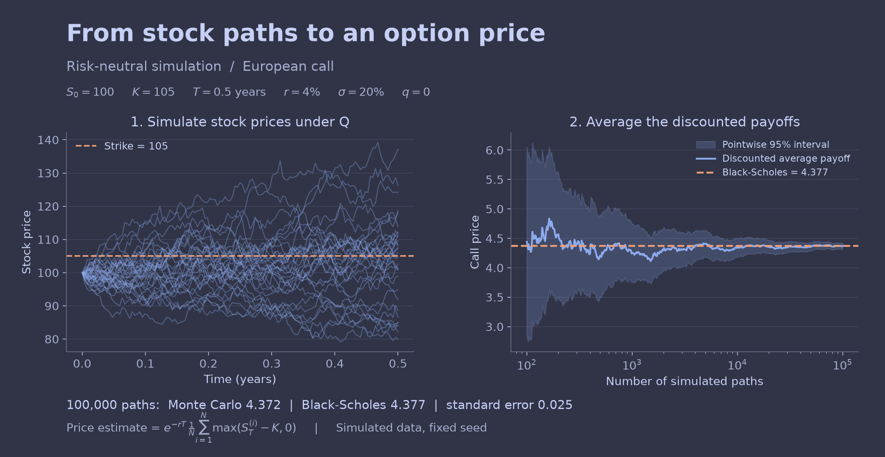

## Introduction

In this (mini) project we shall be exploring one of the most famous models in financial mathematics.  In the early 1970s, the economists Fischer Black, Myron Scholes and Robert Merton developed the Black-Scholes-Merton model [@black1973; @merton1973] which allowed them to derive a closed form solution for the pricing of European options.  We will first introduce the model and derive the Black-Scholes Partial Differential Equation (PDE).  We will then derive the 
closed form solution for the prices of European call and put options, once 
by using the Black-Scholes PDE and once by using risk-neutral pricing.
Finally, we implement the Black-Scholes formula in Python, validate it
numerically, and provide a reproducible workflow for comparing European
options with a saved market snapshot. No market snapshot is included here,
so the empirical comparison remains an exercise.

## The Black-Scholes-Merton Model

The Black-Scholes-Merton model assumes that a market consists of two assets: 

1. A risk-free asset (zero-coupon bond) with price $B_t$ at time $t$ 
   which grows at a constant risk-free interest rate $r$.

2. A risky asset (stock) with price $S_t$ at time $t$ which follows a 
   geometric Brownian motion with constant drift $\mu$ and volatility $\sigma$.

The dynamics are summarized as 

$$
\begin{cases}
  dB_t & = r B_t dt, \\
  dS_t & = \mu S_t dt + \sigma S_t dW_t,
\end{cases}
$$

where $W_t$ is a standard Brownian motion, $\mu$ is the drift coefficient 
and $\sigma$ is the diffusion coefficient.  The stock price is therefore a
[[geometric-brownian-motion]], with solution

$$
S_t = S_0\exp\left( \left( \mu - \frac{\sigma^2}{2} \right)t + \sigma W_t \right),
$$

so $S_t$ is [[log-normal-distribution|log-normally]] distributed.  The model
and its assumptions (constant coefficients, continuous frictionless trading,
no dividends) are discussed in more detail in
[[black-scholes-merton-model]].  Throughout we price a **European option**
(see [[european-options]]) with maturity $T$ and payoff $h(S_T)$, where

$$
h_{\text{call}}(S_T) = (S_T - K)^+, \qquad h_{\text{put}}(S_T) = (K - S_T)^+,
$$

and $K$ is the strike price.

## The Black-Scholes PDE

Let $V(t,S_t)$ be the price at time $t$ of a derivative with payoff $h(S_T)$.
The idea is to **delta-hedge**: hold the option together with $\Delta_t$
shares of stock and $\alpha_t$ units of the bond so that the randomness
cancels.
The portfolio

$$
\Pi_t = V(t,S_t) + \Delta_t S_t + \alpha_t B_t
$$

is chosen to be **self-financing**, so that its value changes only through
changes in asset prices (see [[risk-neutral-pricing]]),

$$
d\Pi_t = dV + \Delta_t\,dS_t + \alpha_t\,dB_t.
$$

By [[ito-formula|Itô's formula]],

$$
dV = \left( \partial_t V + \mu S_t\,\partial_S V
+ \frac{1}{2}\sigma^2 S_t^2\,\partial_{SS} V \right)dt
+ \sigma S_t\,\partial_S V\,dW_t.
$$

Substituting this and the dynamics of $S$ and $B$ gives

$$
d\Pi_t = \left( \partial_t V + \mu S_t(\partial_S V + \Delta_t)
+ \frac{1}{2}\sigma^2 S_t^2\,\partial_{SS} V + r\alpha_t B_t \right)dt
+ \sigma S_t(\partial_S V + \Delta_t)\,dW_t.
$$

Choosing $\Delta_t = -\partial_S V$ removes the $dW_t$ term, and also the
drift $\mu$ of the stock. The portfolio $\Pi_t = V - S_t\partial_S V +
\alpha_t B_t$ is then riskless over $dt$, so to avoid arbitrage it must grow at
the risk-free rate, $d\Pi_t = r\Pi_t\,dt$. Equating the two expressions for
$d\Pi_t$, the $r\alpha_t B_t$ terms cancel and we obtain the
**Black-Scholes PDE**

$$
\begin{cases}
\partial_t V + \dfrac{1}{2}\sigma^2 S^2\,\partial_{SS} V
+ rS\,\partial_S V - rV = 0, \\[1ex]
V(T,S) = h(S).
\end{cases}
$$

The drift $\mu$ does not appear: the option price does not depend on the
expected return of the stock. In terms of the Greeks ([[option-greeks]]) the
PDE reads $\Theta + \frac{1}{2}\sigma^2 S^2\Gamma + rS\Delta - rV = 0$.

## Pricing European Options

### Solution of the Black-Scholes PDE

We reduce the PDE to the [[heat-equation|heat equation]]. Let $\tau = T-t$ be
the time to maturity and change variables to

$$
x = \log S + \left( r - \frac{\sigma^2}{2} \right)\tau, \qquad
V(t,S) = e^{-r\tau}u(\tau,x).
$$

Computing the derivatives,

$$
\partial_t V = e^{-r\tau}\left( ru - \partial_\tau u
- \left( r - \tfrac{\sigma^2}{2} \right)\partial_x u \right), \quad
\partial_S V = \frac{e^{-r\tau}}{S}\partial_x u, \quad
\partial_{SS} V = \frac{e^{-r\tau}}{S^2}\left( \partial_{xx}u - \partial_x u \right),
$$

and substituting into the PDE, all terms in $u$ and $\partial_x u$ cancel,
leaving

$$
\partial_\tau u = \frac{\sigma^2}{2}\,\partial_{xx} u, \qquad u(0,x) = h(e^x).
$$

This is the heat equation with diffusivity $\sigma^2/2$ and initial condition
$h(e^x)$. Its solution on the whole line is the convolution of the initial
condition with the Gaussian heat kernel (see [[heat-equation]]),

$$
u(\tau,x) = \int_{-\infty}^\infty \frac{1}{\sqrt{2\pi\sigma^2\tau}}
\exp\left( -\frac{(x-y)^2}{2\sigma^2\tau} \right) h(e^y)\,dy
= \mathbb{E}\left[ h\left( e^{x + \sigma\sqrt{\tau}Z} \right) \right],
\qquad Z \sim \mathcal{N}(0,1).
$$

Returning to the original variables, $e^x = S e^{(r-\sigma^2/2)\tau}$ so

$$
V(t,S) = e^{-r\tau}\,\mathbb{E}\left[ h\left( S\exp\left( \left( r -
\tfrac{\sigma^2}{2} \right)\tau + \sigma\sqrt{\tau}Z \right) \right) \right].
\tag{1}
$$

For a call, $h(S_T) = (S_T - K)^+$ and $S_T = S e^{(r-\sigma^2/2)\tau +
\sigma\sqrt{\tau}Z}$ exceeds $K$ exactly when $Z > -d_-$, where

$$
d_{\pm} = \frac{1}{\sigma\sqrt{\tau}}
\left( \log\frac{S}{K} + \left( r \pm \frac{\sigma^2}{2} \right)\tau \right).
$$

Splitting the expectation into the two terms of the payoff, using that
$\mathbb{P}(Z > -d_-) = N(d_-)$ with $N$ the standard
[[normal-distribution|normal]] cumulative distribution function, and the
Gaussian identity
$\mathbb{E}[e^{\sigma\sqrt{\tau}Z}\mathbf{1}_{\{Z>-d_-\}}] =
e^{\sigma^2\tau/2}N(d_-+\sigma\sqrt{\tau})$, we get

$$
\mathbb{E}\left[ S_T\mathbf{1}_{\{S_T>K\}} \right] = Se^{r\tau}N(d_+),
\qquad
\mathbb{E}\left[ K\mathbf{1}_{\{S_T>K\}} \right] = KN(d_-),
$$

and therefore by (1)

:::{.theorem data-title="Black-Scholes Formulas"}

$$
\begin{aligned}
C(S,t) &= S\,N(d_+) - Ke^{-r\tau}N(d_-), \\
P(S,t) &= Ke^{-r\tau}N(-d_-) - S\,N(-d_+).
\end{aligned}
$$

:::

The put price follows in the same way, or from put-call parity
$C - P = S - Ke^{-r\tau}$ (see [[european-options]]).  The
sensitivities of these prices with respect to $S$, $\sigma$, $r$ and $t$ are the
Greeks, discussed in [[option-greeks]].

### Risk-Neutral Pricing

The second derivation avoids the PDE.  By the fundamental theorem of asset
pricing ([[risk-neutral-pricing]]), the price of a derivative is the discounted
expected payoff under the risk-neutral measure $\mathbb{Q}$,

$$
V(t) = e^{-r(T-t)}\,\mathbb{E}_{\mathbb{Q}}\left[ h(S_T) \mid \mathcal{F}_t \right].
$$

To find $\mathbb{Q}$ we use [[girsanov-theorem|Girsanov's theorem]]: define the
[[radon-nikodym-derivative]]

$$
\frac{d\mathbb{Q}}{d\mathbb{P}}\Big|_{\mathcal{F}_t}
= \exp\left( -\theta W_t - \frac{1}{2}\theta^2 t \right),
\qquad \theta = \frac{\mu - r}{\sigma},
$$

so that $W_t^{\mathbb{Q}} = W_t + \theta t$ is a Brownian motion under
$\mathbb{Q}$.  The stock dynamics become

$$
dS_t = rS_t\,dt + \sigma S_t\,dW_t^{\mathbb{Q}}, \qquad
S_T = S_t\exp\left( \left( r - \frac{\sigma^2}{2} \right)(T-t)
+ \sigma\left( W_T^{\mathbb{Q}} - W_t^{\mathbb{Q}} \right) \right),
$$

and the discounted price $e^{-rt}S_t$ is a [[martingale-theory|martingale]]
under $\mathbb{Q}$.  Since $W_T^{\mathbb{Q}} - W_t^{\mathbb{Q}} \sim
\mathcal{N}(0, T-t)$ is independent of $\mathcal{F}_t$, this is exactly the
random variable in (1), so the risk-neutral price coincides with the
solution of the PDE and we recover the Black-Scholes formulas.  The
connection between the two approaches is the
[[feynman-kac-formula]], which states that the solution of the PDE is the
risk-neutral expectation.

Note that $\mu$ has disappeared: under $\mathbb{Q}$ the stock has drift
$r$, and discounted tradable asset prices are martingales. The volatility
$\sigma$ is the same under $\mathbb{P}$ and
$\mathbb{Q}$, so it is the only model parameter that must be estimated.

## Implementation in Python

We take time to maturity $\tau$ in years. For index options we extend the
no-dividend model to a constant continuous dividend yield $q$. Then

$$
d_+ = \frac{\log(S/K)+(r-q+\sigma^2/2)\tau}{\sigma\sqrt{\tau}},
\qquad d_- = d_+ - \sigma\sqrt{\tau},
$$

$$
C = Se^{-q\tau}N(d_+) - Ke^{-r\tau}N(d_-), \qquad
P = Ke^{-r\tau}N(-d_-) - Se^{-q\tau}N(-d_+).
$$

This is the dividend adjustment used in
[S&P's option index methodology](https://www.spglobal.com/spdji/en/documents/index-policies/methodology-sp-options-indices-policies-practices.pdf).
Setting $q=0$ recovers the derivation above. At expiry the price is the
payoff; at zero volatility it is the discounted deterministic payoff.
Inputs may be scalars or broadcast-compatible arrays. Spot and strike must
be positive; time and volatility must be nonnegative and all inputs finite.

```{python}
import numpy as np
from scipy.stats import norm


def checked_inputs(S, K, tau, r, sigma, q):
    values = np.broadcast_arrays(*[
        np.asarray(v, dtype=float) for v in (S, K, tau, r, sigma, q)
    ])
    if any(np.any(~np.isfinite(v)) for v in values):
        raise ValueError("all inputs must be finite")
    S, K, tau, r, sigma, q = values
    if np.any(S <= 0) or np.any(K <= 0):
        raise ValueError("spot and strike must be positive")
    if np.any(tau < 0) or np.any(sigma < 0):
        raise ValueError("time and volatility must be nonnegative")
    return values


def d_plus_minus(S, K, tau, r, sigma, q=0.0):
    """Return d_+ and d_- for strictly positive time and volatility."""
    S, K, tau, r, sigma, q = checked_inputs(S, K, tau, r, sigma, q)
    if np.any(tau == 0) or np.any(sigma == 0):
        raise ValueError("d values require positive time and volatility")
    scale = sigma * np.sqrt(tau)
    d_plus = (np.log(S) - np.log(K) +
              (r - q + 0.5 * sigma**2) * tau) / scale
    return d_plus, d_plus - scale


def bs_price(S, K, tau, r, sigma, kind="call", q=0.0):
    """European option price with continuous dividend yield q."""
    if kind not in ("call", "put"):
        raise ValueError("kind must be 'call' or 'put'")
    S, K, tau, r, sigma, q = checked_inputs(S, K, tau, r, sigma, q)
    spot_pv = S * np.exp(-q * tau)
    strike_pv = K * np.exp(-r * tau)
    sign = 1 if kind == "call" else -1
    result = np.array(np.maximum(sign * (spot_pv - strike_pv), 0))
    regular = (tau > 0) & (sigma > 0)
    if np.any(regular):
        dp, dm = d_plus_minus(*[
            v[regular] for v in (S, K, tau, r, sigma, q)
        ])
        result = result.copy()
        result[regular] = sign * (
            spot_pv[regular] * norm.cdf(sign * dp)
            - strike_pv[regular] * norm.cdf(sign * dm)
        )
    return result.item() if result.ndim == 0 else result
```

### Validation

We check the implementation against two properties.  First, put-call parity
$C - P = S - Ke^{-r\tau}$ holds up to rounding error.  Second, the closed form
matches a Monte Carlo estimate of the risk-neutral expectation (1), using
$10^6$ simulated terminal prices.

```{python}
S, K, tau, r, sigma = 100.0, 105.0, 0.5, 0.04, 0.2

call = bs_price(S, K, tau, r, sigma, "call")
put = bs_price(S, K, tau, r, sigma, "put")
print(f"call = {call:.4f}, put = {put:.4f}")
print(f"parity error = {call - put - (S - K * np.exp(-r * tau)):.2e}")

rng = np.random.default_rng(seed=1)
Z = rng.standard_normal(1_000_000)
S_T = S * np.exp((r - 0.5 * sigma**2) * tau + sigma * np.sqrt(tau) * Z)
disc = np.exp(-r * tau)
for name, payoff, exact in [
    ("call", np.maximum(S_T - K, 0), call),
    ("put", np.maximum(K - S_T, 0), put),
]:
    est = disc * payoff.mean()
    se = disc * payoff.std() / np.sqrt(len(Z))
    print(f"{name}: Monte Carlo = {est:.4f} (se {se:.4f}), exact = {exact:.4f}")
```

### Visualizing Monte Carlo Pricing

Each simulated stock path is a possible realization of the same
risk-neutral geometric Brownian motion. We use drift $r$, rather than the
stock's historical expected return $\mu$, because pricing requires the
risk-neutral expectation. For this illustration, $q=0$.

At each time step we simulate the exact transition

$$
S_{t+\Delta t} = S_t\exp\left[
\left(r-\frac{\sigma^2}{2}\right)\Delta t
+\sigma\sqrt{\Delta t}\,Z\right], \qquad Z\sim N(0,1),
$$

using independent normal draws across paths and time steps. This avoids
time-discretization bias in the terminal stock distribution. The call price
estimate from $N$ paths is

$$
\widehat C_N = \frac{1}{N}\sum_{i=1}^N
e^{-rT}(S_T^{(i)}-K)^+.
$$

{#fig-monte-carlo-pricing}

The left panel shows 32 of 100,000 simulated paths. Paths finishing below
the strike contribute zero; paths finishing above it contribute their
discounted payoff. The right panel averages payoffs over progressively
more paths. Its horizontal axis is logarithmic. The shaded band is the
approximate pointwise 95% confidence interval
$\widehat C_N\pm1.96s_N/\sqrt{N}$, where $s_N$ is the sample standard
deviation of discounted payoffs. It describes sampling uncertainty at each
sample size, rather than a simultaneous guarantee for the entire curve.

With seed 7 and the parameters shown, the Monte Carlo price is **4.372**,
the Black-Scholes price is **4.377**, and the standard error is **0.025**.
Increasing the number of paths reduces typical sampling error at rate
$N^{-1/2}$; the estimate need not approach the exact price monotonically.
This is a simulation check under the model's assumptions, not evidence of
agreement with market prices.

The [figure source](pricing_visualization.py) saves the same image used by
this page and its gallery card. Regenerate it from the repository root:

```{.bash}
.venv/bin/python projects/bs-option-pricing/pricing_visualization.py
```

### Comparison with Market Data

The model has one unknown parameter, the volatility $\sigma$.  The
market quotes option prices rather than $\sigma$, so we invert the formula
numerically to obtain the **implied volatility** $\sigma_{\text{imp}}$ that
reproduces an observed price.  Since the call price is strictly increasing in
$\sigma$ (the vega of [[option-greeks]] is positive), a root finder applies.

```{python}
from scipy.optimize import brentq


def implied_vol(price, S, K, tau, r, kind="call", q=0.0):
    """Scalar IV; reject invalid prices and flag an exhausted bracket."""
    lower = float(bs_price(S, K, tau, r, 0.0, kind, q=q))
    if not np.isfinite(price):
        raise ValueError("price must be finite")
    if tau <= 0:
        raise ValueError("IV is undefined at expiry")
    upper = S * np.exp(-q * tau) if kind == "call" else (
        K * np.exp(-r * tau)
    )
    if price < lower or price >= upper:
        raise ValueError("price outside finite-IV bounds")
    if price == lower:
        return 0.0
    f = lambda sigma: bs_price(S, K, tau, r, sigma, kind, q=q) - price
    hi = 1.0
    while f(hi) < 0 and hi < 64.0:
        hi *= 2
    if f(hi) < 0:
        raise ValueError("IV exceeds numerical search limit")
    return brentq(f, 0.0, hi)


print(implied_vol(call, S, K, tau, r))  # recovers sigma = 0.2
```

For a market comparison, use a saved, dated snapshot rather than fetching
changing data during the site build. An SPX snapshot must include dividends
and distinguish AM-settled SPX from PM-settled SPXW contracts; see
[Cboe's specifications](https://www.cboe.com/tradable-products/sp-500/spx-options/spx-specifications/).
Use the actual settlement date and time from the contract specification,
including any holiday adjustment. Do not infer it from an expiry date alone.

Save `market-snapshot.csv` with one row per contract and these columns:

- `contract`, `kind`, `strike`, `bid`, `ask`.
- `quote_time`, `valuation_time`, `settlement_time`: ISO 8601 timestamps
  with explicit UTC offsets. Quote and spot observations should be aligned.
- `spot`, `r`, `q`, `sigma_hist`: spot at the valuation time, continuously
  compounded annual rate, estimated continuous dividend yield over the
  option's life, and annualized historical volatility.
- `source`, `rate_source`, `dividend_source`, `history_source`: provenance
  for quotes and each estimated input, including the historical window.

For example, estimate `sigma_hist` as the sample standard deviation of
one year of daily log returns multiplied by $\sqrt{252}$. Use a rate and
dividend estimate appropriate to the maturity. These choices are estimates,
not measured constants. Keep the original snapshot alongside the derived
CSV and plot. The following optional block requires that snapshot; no
market results are claimed until it has been supplied and inspected.

```{python}
#| eval: false
import pandas as pd
import matplotlib.pyplot as plt


def compare_snapshot(snapshot):
    """Analyze each quote independently, retaining reasons for rejection."""
    rows = []
    for row in snapshot.to_dict("records"):
        result = dict(row, mid=np.nan, bs_hist=np.nan, iv=np.nan,
                      tau=np.nan, status="ok")
        try:
            times = [pd.Timestamp(row[key]) for key in (
                "quote_time", "valuation_time", "settlement_time"
            )]
            if any(pd.isna(t) or t.tzinfo is None for t in times):
                raise ValueError("timestamps require explicit UTC offsets")
            quote_time, valuation_time, settlement_time = times
            # This exercise accepts at most one minute of misalignment.
            if abs((quote_time - valuation_time).total_seconds()) > 60:
                raise ValueError("quote and spot times are not aligned")
            tau = (settlement_time - valuation_time).total_seconds()
            tau /= 365 * 24 * 60 * 60  # ACT/365F, including fractional days
            if tau <= 0:
                raise ValueError("contract has expired")
            bid, ask = float(row["bid"]), float(row["ask"])
            if not (np.isfinite(bid) and np.isfinite(ask)):
                raise ValueError("bid and ask must be finite")
            if bid <= 0 or ask < bid:
                raise ValueError("nonpositive bid or crossed market")
            S, K, r, q, sigma = [float(row[key]) for key in (
                "spot", "strike", "r", "q", "sigma_hist"
            )]
            mid = (bid + ask) / 2
            hist = bs_price(S, K, tau, r, sigma, row["kind"], q=q)
            iv = implied_vol(mid, S, K, tau, r, row["kind"], q=q)
            result.update(mid=mid, tau=tau, bs_hist=hist, iv=iv)
        except (ValueError, TypeError, KeyError, OverflowError) as exc:
            result["status"] = str(exc)
        rows.append(result)
    return pd.DataFrame(rows)


snapshot = pd.read_csv("market-snapshot.csv")
results = compare_snapshot(snapshot)
results.to_csv("market-comparison.csv", index=False)
print(results.to_string(index=False))

valid = results.loc[results["status"] == "ok"]
if not valid.empty:
    fig, ax = plt.subplots()
    # Compare strikes only within the same expiry and option type.
    for label, group in valid.groupby(["settlement_time", "kind"]):
        group = group.sort_values("strike")
        ax.plot(group["strike"], group["iv"], "o-", label=str(label))
    ax.set(xlabel="Strike", ylabel="Implied volatility")
    ax.legend()
    fig.tight_layout()
    fig.savefig("market-iv.png", dpi=150)
    plt.show()
```

Repricing each contract with its own implied volatility is a calibration
identity, not independent validation. A difference between historical-
volatility prices and market quotes can reflect estimation error, bid-ask
spreads or mismatched inputs. Evidence against a single volatility requires
comparing implied volatilities across strikes at the same maturity, with
consistent rates, dividends and observation times, and checking whether
variation exceeds quote uncertainty. A smile or skew would motivate the
models in [[volatility-surfaces]], [[local-volatility-model]] and
[[stochastic-volatility-model|stochastic volatility models]], including
[[heston-model]]. No such pattern has been established by this project yet.

## Conclusion

We derived the Black-Scholes PDE by delta-hedging, solved it by reduction to
the heat equation and, independently, by risk-neutral pricing, and obtained
the closed-form prices of European calls and puts.  The two approaches agree
because of the Feynman-Kac formula.  The implementation reproduces
put-call parity and a Monte Carlo estimate. The optional snapshot workflow
includes dividends, precise settlement times and quote validation; an
empirical conclusion awaits a saved dataset and its results. For the general
theory see [[black-scholes-merton-model]], [[european-options]] and
[[option-pricing]].

## References
