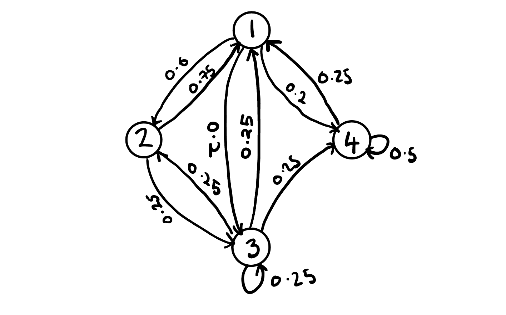
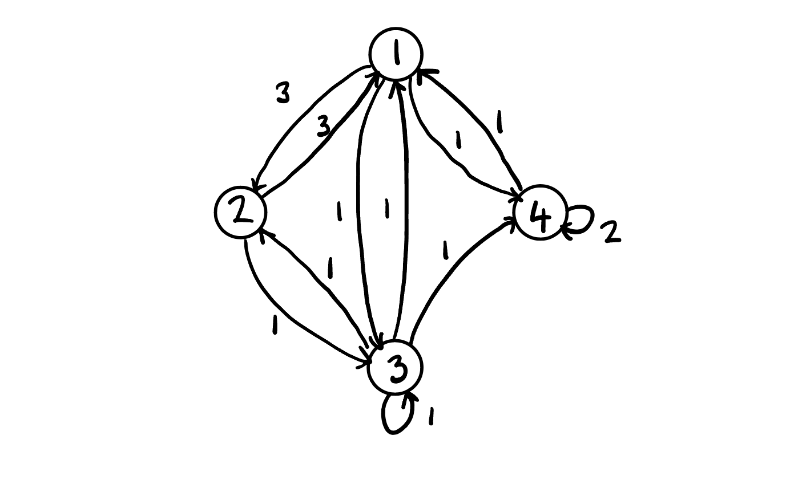
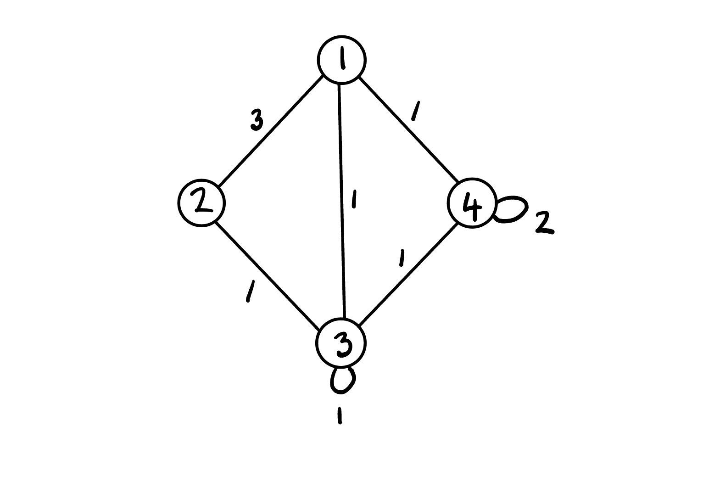
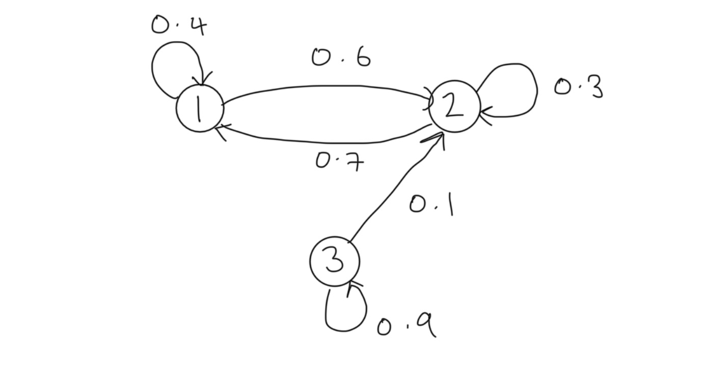

```{python}
#| echo: false
# Packages
import numpy as np
import matplotlib.pyplot as plt
```

## Markov Property

In probability theory a stochastic process is said to satisfy the 
_Markov property_ if its future evolution is _independent of its history_, 
that is, the process is _memoryless_.  Consider a discrete time stochastic 
process $\{X_t\}_{t\in\mathbb{N}}$ defined in the probability space 
$(\Omega,\mathcal{F}, \mathbb{P})$.

::: {.definition data-title="Markov Property"}
The discrete time stochastic process $\{X_t\}_{t\in\mathbb{N}}$ is said to 
satisfy the _Markov property_ if 

$$
\mathbb{P}(X_{n+1}=x_{n+1}|X_n=x_n, ..., X_1=x_1)
=\mathbb{P}(X_{n+1}=x_{n+1}|X_n=x_n).
$$

:::

Intuitively, we see that we gain no additional information about the 
probability of the next value of the process by conditioning on the entire 
history rather than the latest value.  Any process satisfying the Markov 
property is called a **Markov process** (see [[markov-property]] for the general 
and strong versions, and [[markov-process]] for continuous time).

## Markov chains

A Markov process with a discrete state space is known as a 
**Markov chain (MC)**.  Assume that $\{X_t\}_{t\in\mathbb{N}}$ is a Markov 
chain with finite state space $\mathcal{X}:=\{1, ..., M\}$.  The evolution of 
the chain in time is described by **transition probabilities** 
$p_{i,j}^{(n)}(t)$ which give the probability that the chain is in state 
$j$ at time $t+n$ given that the chain was in $i$ at time $t$

$$
p_{i,j}^{(n)}(t)=\mathbb{P}(X_{t+n}=j|X_{t}=i).
$$

We summarize the transition probabilities in an $M\times M$ 
**transition probability matrix** denoted by

$$
P^{(n)}(t)=(p_{i,j}^{(n)}(t))_{i,j\in\mathcal{X}}.
$$

The transition probability matrix is _stochastic_ which means that for all 
$n,t\in\mathbb{N}$ we have:

1. $0\leq p_{i,j}^{(n)}(t)<1$ for all $i,j\in \mathcal{X}$,
2. $\sum_{{j\in S}}p_{{i,j}}^{(n)}(t)=1$ for all $i\in \mathcal{X}$ 
   (the rows sum to 1).

To simplify notation we denote the _one-step transition probablity matrix_

$$
P(t)=(p_{i,j}(t))_{i,j\in\mathcal{X}}.
$$

The transition probabilities are _stationary_ when they are invariant in time, 
that is

$$
p_{i,j}^{(n)}(t)=p_{i,j}^{(n)}(s);~~\forall s,t\in\mathbb{N}.
$$

We say that a MC is **homogenous** if it has stationary transition 
probabilities.  For homogenous MCs we are often interested in the one-step 
transition probabilities and so again to clarify notation we denote the 
one-step transition probability matrix for homogenous MCs as

$$
P=(p_{i,j})_{i,j\in\mathcal{X}}.
$$

::: {.example data-title="Transition Matrix"}
Consider a homogenous MC $\{X_t\}$ with finite state space 
$\mathcal{S}:=\{1,2,3,4\}$ with transition probability matrix

$$
P = \begin{bmatrix}
0 & 0.6 & 0.2 & 0.2 \\
0.75 & 0 & 0.25 & 0 \\
0.25 & 0.25 & 0.25 & 0.25 \\
0.25 & 0 & 0.25 & 0.5
\end{bmatrix}.
$$

:::

## Transition Diagrams

To gain deeper insight into the behavior of the chain we typically will 
produce _transition probability diagram_ which takes the form of a directed 
graph with nodes denoting states and weighted directed arrows the transition 
probabilities.  The transition probability diagram for our example is

{width=50%}

There are several alternate versions of this diagram including the _integer 
weighted diagram_. To construct the integer-weighted diagram we compute the 
inter-weighted matrix by multiplying elements of each row by the lowest common 
multiple for that row.  The integer weighted matrix for our example is

$$
P = \begin{bmatrix}
0 & 3 & 1 & 1 \\
3 & 0 & 1 & 0 \\
1 & 1 & 1 & 1 \\
1 & 0 & 1 & 2
\end{bmatrix}.
$$

The corresponding diagram is

{width=50%}

Since our diagram has a symmetric integer-weighted transition matrix we can 
also write the _non-directed version_ by combining the equally weighted 
directed arrows into a single non-directed line

{width=50%}

## State Distributions

The **state distribution** $\mu_i(t)$ gives the probability that the chain is 
in state $i$ at time $t$

$$
\mu_i(t)=\mathbb{P}(X_{t}=i).
$$

For convenience we summarize the state distributions in vector notation
$$
\boldsymbol{\mu}(t)=(\mu_i(t))_{i \in \mathcal{X}}.
$$

Of particular interest is the **initial state distribution**
$$
\boldsymbol{\mu}(0)=\boldsymbol{\mu}=(\mu_i(0))_{i \in\mathcal{X}}.
$$

For conveinence we also introduce the following notation for process vectors
$$
X_{1:t} = (X_1, ..., X_t),
$$

where similarly $X_{1:t}=x_{1:t}$ is equivalent to $X_1=x_1, ..., X_t=x_t$.

_Finite-dimensional distributions_ allow us to evaluate the behavior of the 
distribution of infinite length processes by selecting some sub-sequence of 
index values to evaluate their joint distribution.

::: {.theorem data-title="Finite-Dimensional Distributions"}
The *finite-dimensional distributions* of $X=(X_{n})_{n}$ are determined by 
the initial mass $\mu^{(0)}$ and transition matrix $P$ where 

$$
P(X_{0}=i_{0}, \dots, X_{n}=i_{n})=
\mu_{{x_{0}}}^{(0)}p_{x_{0}, x_{1}}(0)p_{x_{1}, x_{2}}(1)\cdots 
p_{x_{n-1}, x_{n}}(n-1).
$$
:::

::: {.proof}
From application of the Chain Rule and the Markov Property we see that
$$
\begin{align}
\mathbb{P}&(X_{1 : n}=x_{1: n}) & \\
 & = \mathbb{P}(X_{0}=x_{0}) \mathbb{P}(X_{1}=x_{1}|X_{0}=x_{0})
 \mathbb{P}(X_{2}=x_{2}|X_{0 : 1}=x_{0 : 1})\cdots \\
 & \quad \cdots \mathbb{P}(X_{n}=x_{n}|X_{0 : n-1}=x_{0: n-1})  \\
  & =\mathbb{P}(X_{0}=x_{0})\mathbb{P}(X_{1}=x_{1}|X_{0}=x_{0})
  \mathbb{P}(X_{2}=x_{2}|X_{1}=x_{1})\cdots \\
  & \quad \cdots \mathbb{P}(X_{n}=x_{n}|X_{n-1}=x_{n-1})  \\
& = \mu_{{x_{0}}}^{(0)}p_{x_{0}, x_{1}}(0)p_{x_{1}, x_{2}}(1)
\cdots p_{x_{n-1}, x_{n}}(n-1),
\end{align}
$$

as required.
:::

::: {.theorem data-title="Multi-Step Transition Probabilities for 
Homogenous MCs"}
Let $\{ X_{n} \}$ be a homogenous MC with one-step transition probability 
matrix $P$. The $m$-step transition probabilities are given by raising the 
one-step transition probability matrix to the $m$-th power 
$$
P^{(m)}=(\mathbb{P}(X_{m}=j|X_{0}=i))_{i,j}=P^m.
$$
:::

::: {.proof}
The result follows immediately from the Markov property since
$$
\begin{aligned}
\mathbb{P}(X_{m}|X_{0}) & =\mathbb{P}(X_{m}|X_{m-1})\mathbb{P}(X_{m-1}|X_{0}) \\
& = \qquad \vdots \\
& = \mathbb{P}(X_{m}|X_{m-1})\cdots \mathbb{P}(X_{1}|X_{0}) \\
& = [\mathbb{P}(X_{1}|X_{0})]^m.
\end{aligned}
$$
:::

::: {.example data-title="Multi-Step Probabilities"}
Consider a homogenous MC with state space $\mathcal{S}:=\{ 1,2,3 \}$ with
transition probability matrix $P$ and initial state distribution $\mu$ given
respectively by
$$
P:=\begin{bmatrix}
0.4 & 0.6 & 0 \\
0.7 & 0.3 & 0  \\
0 & 0.1 & 0.9
\end{bmatrix},~~\mu=\begin{bmatrix}
0.1 & 0.2 & 0.7
\end{bmatrix}.
$$

The transition probability diagram for this chain is

{width=50%}

Suppose we wish to determine the $3$-step transition probabilities. Applying
the multi-step transition result we can compute $\mathbb{P}(X_3|X_0)$ as $P^3$:
```{python}
P = np.array([
    [.4, .6, 0],
    [.7, .3, 0],
    [0, .1, .9]
])
P3 = np.linalg.matrix_power(P,3); print(P3)
```

Furthermore, let us suppose that we wish to determine the 3-step state
distribution. From the finite-dimensional distribution we see that
$$
\begin{aligned}
\mathbb{P}(X_3) & =\mathbb{P}(X_0)\mathbb{P}(X_1|X_0)\mathbb{P}(X_2|X_1)\mathbb{P}(X_3|X_2) \\
 & = \boldsymbol{\mu}P^3.
\end{aligned}
$$

Thus we can compute:
```{python}
mu = np.array([
    0.1, 0.2, 0.7
])
mu@(P3)
```
:::

## Chapman Kolmogorov Equations

The _Chapman-Kolmogorov Equations (CKE)_ relate the joint probability
distributions of different sets of coordinates on a stochastic process.

::: {.theorem data-title="Chapman-Kolmogorov Equations"}
For a discrete time countable state homogeneous Markov chain the
Chapman-Kolmogorov equations state that
$$
P_{n+m}=P_{n}\cdot P_{m},
$$
or equivalently
$$
p^{(n+m)}_{i,j}=\sum_{k\in S}p^{(n)}_{i,k}p^{(m)}_{k,j}.
$$
:::

A similar result holds for distributions
$$
\mu_{j}^{(n+m)}=\sum_{i \in S}\mu_{i}^{(n)}p_{i,j}(m),
$$

or in matrix form
$$
\boldsymbol{\mu}^{(n+m)}=\boldsymbol{\mu}^{(n)}P_{m}=\boldsymbol{\mu}^{(n)}P^m\quad\&\quad \boldsymbol{\mu}^{(n)}=\boldsymbol{\mu}^{(0)}P^n.
$$

## Related Markov models

A **Markov model** is a stochastic model assuming the [[markov-property|Markov
property]], used to model randomly changing systems in discrete time. Four
common models arise depending on whether the state is fully observable and
whether the system is adjusted on the basis of the observations.

| System state   | Fully observable      | Partially observable                |
| -------------- | --------------------- | ----------------------------------- |
| **Autonomous** | [[markov-chains]]     | [[hidden-markov-models]]            |
| **Controlled** | Markov decision process (see [[stochastic-control]]) | Partially observable MDP |

## Sub-topics

The theory of Markov chains is developed in the following notes.

- [[markov-chain-state-classification]]: communication, persistence,
  transience, periodicity.
- [[markov-chain-passage-recurrence-times]]: hitting and mean recurrence
  times.
- [[markov-chain-excursions-state-visits]]: excursions and expected visits.
- [[markov-chain-stationary-distributions]]: limiting and stationary
  distributions, invariant measures.
- [[markov-chain-equilibrium-convergence]]: convergence to equilibrium.
- [[markov-chain-time-averages]]: ergodic averages.
- [[markov-chain-time-reversibility]]: reversed chains and detailed balance.
- [[markov-chain-statistical-inference]]: estimating transition
  probabilities.
- [[markov-chain-monte-carlo-mcmc-methods]]: sampling by constructing chains.

For continuous time see [[markov-process]], [[jump-processes]],
[[kolmogorov-equations]] and [[infinitesimal-generator]].

## References

- J. R. Norris, *Markov Chains*, Cambridge University Press, 1997.
- G. Grimmett and D. Stirzaker, *Probability and Random Processes*.
